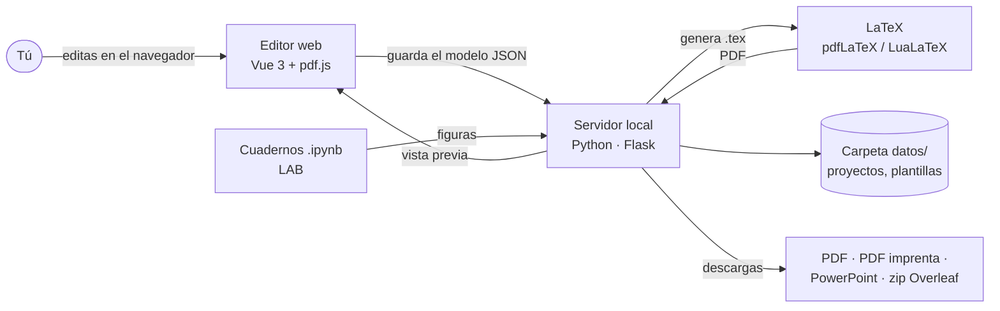
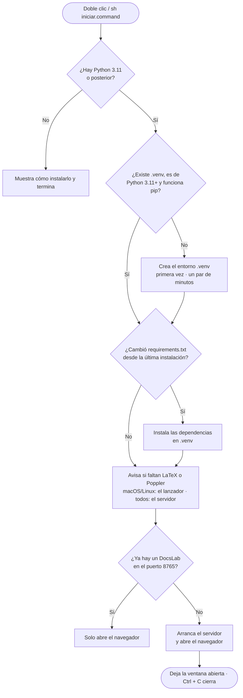
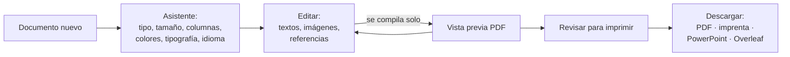
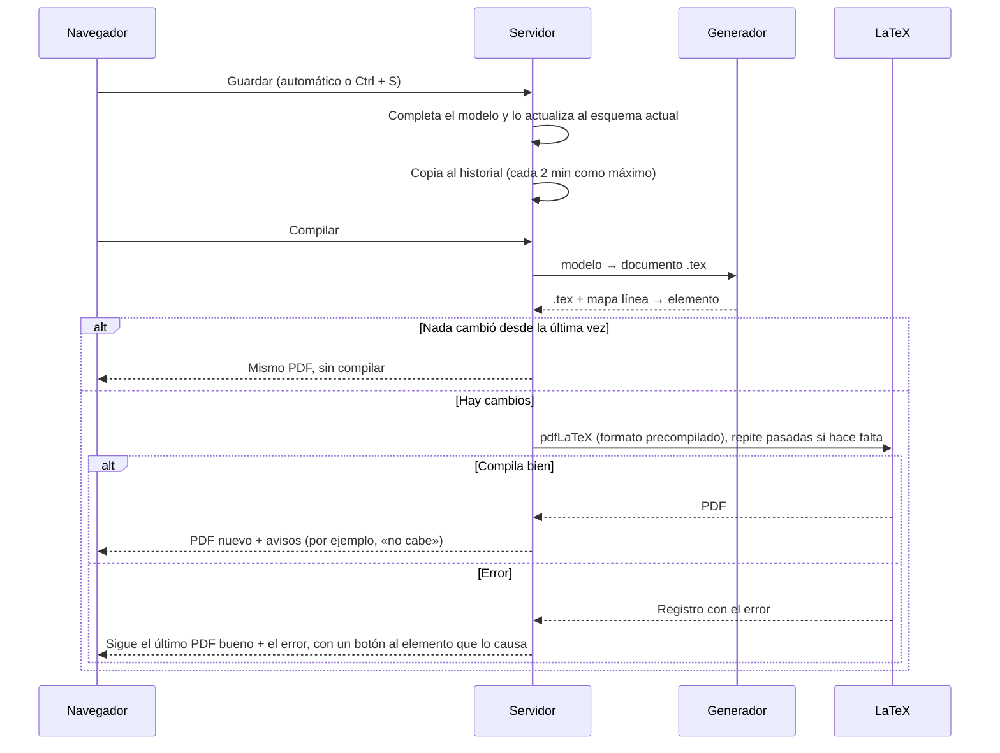
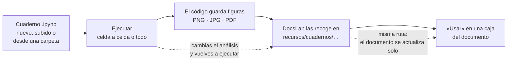
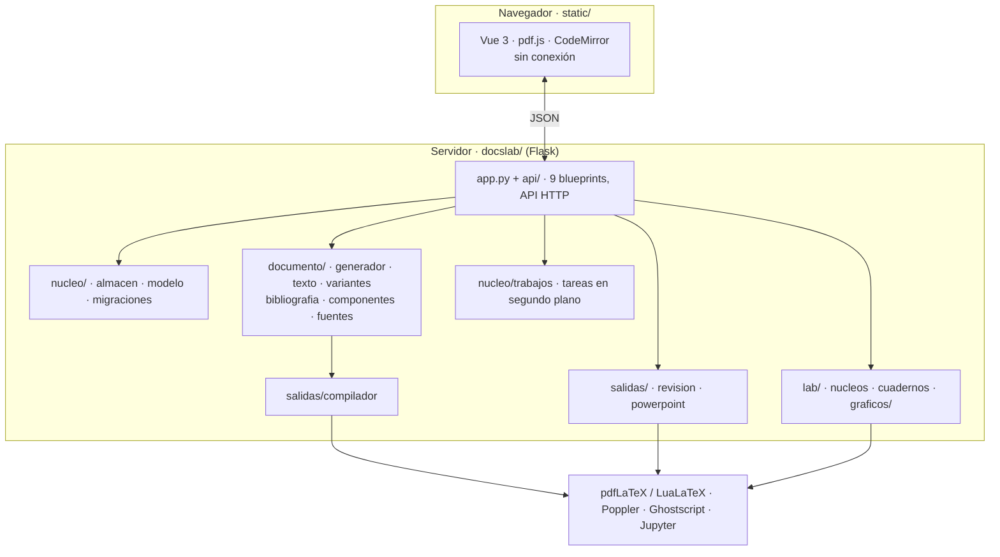

# DocsLab

**Editor web de documentos científicos hechos con LaTeX:** pósters, presentaciones, artículos, tesis y documentos generales. Editas con formularios o directamente sobre la vista previa, ves el PDF real compilado al momento, revisas que esté listo para imprimir y lo descargas en PDF (también preparado para la imprenta), PowerPoint o como zip para Overleaf. Las figuras pueden salir directamente de tus cuadernos de Python.

Funciona **en tu equipo** (Windows, macOS o Linux, con un pequeño servidor local) o **en Google Colab**. Una vez instalado no necesita internet, salvo para buscar referencias por DOI.

**Versión 1.7.0** · Licencia [AGPL-3.0](LICENSE) (plantilla LaTeX: [LPPL-1.3c](latex/LICENSE-LPPL-1.3c.txt)) · [Registro de cambios](CHANGELOG.md) · [Documentación técnica y funcional](docs/README.md) · [Seguridad](SECURITY.md)

---

## Contenido

1. [Qué es y cómo funciona](#1-qué-es-y-cómo-funciona)
2. [Conceptos clave](#2-conceptos-clave)
3. [Qué incluye](#3-qué-incluye)
4. [Requisitos](#4-requisitos)
5. [Instalación y arranque](#5-instalación-y-arranque)
   - [Windows](#51-windows) · [macOS](#52-macos) · [Linux](#53-linux-ubuntu-y-debian) · [Google Colab](#54-google-colab)
   - [Qué hace el lanzador](#55-qué-hace-el-lanzador-los-tres-sistemas) · [Opciones del servidor](#56-opciones-del-servidor)
6. [Primeros pasos: tu primer póster](#6-primeros-pasos-tu-primer-póster)
7. [Cómo se usa el editor](#7-cómo-se-usa-el-editor)
8. [Qué pasa al compilar](#8-qué-pasa-al-compilar)
9. [Referencias bibliográficas](#9-referencias-bibliográficas)
10. [Componente Lab](#10-componente-lab)
11. [Revisión para imprimir y PDF para imprenta](#11-revisión-para-imprimir-y-pdf-para-imprenta)
12. [Tipografías](#12-tipografías)
13. [LAB: cuadernos y gráficos](#13-lab-cuadernos-y-gráficos)
14. [Plantillas](#14-plantillas)
15. [La plantilla LaTeX sin la aplicación](#15-la-plantilla-latex-sin-la-aplicación)
16. [Dónde se guardan tus datos](#16-dónde-se-guardan-tus-datos)
17. [Arquitectura y estructura del código](#17-arquitectura-y-estructura-del-código)
18. [Pruebas](#18-pruebas)
19. [Problemas frecuentes](#19-problemas-frecuentes)
20. [Versionado y documentación](#20-versionado-y-documentación)
21. [Si venías de PosterLab](#21-si-venías-de-posterlab)
22. [Licencia](#22-licencia)

---

## 1. Qué es y cómo funciona

DocsLab separa **lo que escribes** de **cómo se compone**. Tú describes el documento (secciones, cajas, textos, imágenes, referencias) y DocsLab lo traduce a LaTeX, lo compila con pdfLaTeX (o LuaLaTeX) y te muestra el PDF resultante. No hace falta saber LaTeX, pero si lo sabes puedes escribirlo directamente.



- **Todo corre en tu máquina.** El servidor escucha solo en `127.0.0.1` (tu propio equipo); nadie más lo ve salvo que lo abras a la red a propósito.
- **El navegador es solo la interfaz.** Puedes cerrarlo y volver a `http://127.0.0.1:8765` mientras el servidor siga encendido.
- **Tus documentos son carpetas normales** dentro de `datos/`: puedes copiarlas, respaldarlas o llevarlas a otro equipo.

## 2. Conceptos clave

| Concepto | Qué es |
|---|---|
| **Proyecto** | Un documento tuyo: póster, presentación, documento, artículo o tesis. Es una carpeta en `datos/proyectos/`. |
| **Proyecto estructurado** | El modo normal: el documento se guarda como un modelo (`modelo.json`) y se edita con formularios y sobre la vista previa. |
| **Proyecto LaTeX** | El modo código: el documento son archivos `.tex` que editas a mano. Cualquier proyecto estructurado se puede convertir a este modo. |
| **Capas** | Planos del póster: *detrás* (fondos, formas), *contenido* (cabecera, filas, pie) y *delante* (sellos, notas). Se ocultan, se atenúan y se reordenan. |
| **Fila · columna · caja** | La cuadrícula del contenido: las filas contienen columnas, y las columnas contienen cajas con elementos. |
| **Variante (I01–I34, T01–T36)** | Cada forma predefinida de colocar imágenes (I) o texto (T) dentro de una caja. El editor ofrece 69: 32 de imagen, 35 de texto, «LaTeX libre» y «espacio». Las tres de posición absoluta (I30, I31 y T33) solo existen en la plantilla LaTeX; en el editor eso se hace con capas o con posición libre. |
| **Estilo de caja** | El aspecto del recuadro (barra, borde, sombra…). Hay 12. |
| **Plantilla** | Un proyecto de partida. Hay 12 incluidas y puedes guardar las tuyas. |
| **Componente** | Un elemento propio, hecho en el Componente Lab, reutilizable en cualquier documento. |
| **LAB** | El espacio de cuadernos de Python de cada documento, de donde salen figuras que se actualizan solas. |
| **Compilar** | Convertir el documento en PDF con LaTeX. DocsLab lo hace solo al guardar. |
| **Esquema** | La versión de la estructura de `modelo.json`. Los proyectos antiguos se actualizan solos al abrirlos (ver [§16](#16-dónde-se-guardan-tus-datos)). |

## 3. Qué incluye

**Tipos de documento**

| Tipo | Para qué | Rasgos |
|---|---|---|
| **Póster** | Congresos, carteles | Una hoja grande con cabecera, filas, columnas y cajas; capas; posición libre |
| **Presentación** | Charlas | Diapositivas 16:9, 16:10 o 4:3, cada una con su cuadrícula; diseños de portada, título y contenido, sección y en blanco; pie, numeración y barra de avance. Se hace con el motor de DocsLab (no con Beamer), así que usa los mismos elementos, estilos y capas que el póster |
| **Documento** | Informes, guías | Secciones a una o dos columnas |
| **Artículo** | Publicaciones | Título, autores, resumen y palabras clave (también en un segundo idioma), secciones numeradas, figuras, tablas y referencias; a una o dos columnas |
| **Tesis** | Trabajos de grado | Portada (institución, grado, dirección, lugar y fecha), dedicatoria, agradecimientos, resumen, índices, capítulos y apéndices, numeración romana en las páginas preliminares y margen de encuadernación |

**Edición**
- **Editor visual por capas** y **edición directa sobre la vista previa**: arrastrar cajas y elementos (también a otra columna), cambiar el ancho de las columnas, escribir con doble clic y estirar los logos desde su esquina.
- **Posición libre** (pósters y presentaciones): cualquier caja o elemento se puede soltar de la cuadrícula y colocar en cualquier punto; con «Lienzo libre», toda la página. En documentos, artículos y tesis el texto pasa de una página a otra y no hay posición libre.
- **69 variantes** de texto e imagen y **12 estilos de caja**, con miniaturas para elegir. Todas las cajas tienen un título opcional.
- **Texto con formato sencillo** (`**negrita**`, `*cursiva*`, `$x^2$`, `[@cita]`…) o código LaTeX.
- **Deshacer y rehacer, guardado automático e historial de versiones.**

**Contenido**
- **Referencias**: formulario, búsqueda por DOI, importación de BibTeX, RIS y CSL-JSON, y 8 estilos (APA 7, Vancouver, IEEE, Chicago, MLA 9, Harvard, Nature y ACS).
- **Tipografías**: 6 clásicas, 19 libres de TeX Live y las tuyas (`.ttf` y `.otf`).
- **Idioma del documento**: español, inglés, portugués, francés, alemán o italiano (separación de palabras, comillas y textos de las referencias).
- **Componente Lab**: elementos propios, con piezas o con código LaTeX.
- **LAB**: cuadernos de Python celda a celda y plantillas de gráficos (matplotlib, seaborn y plotly). Las figuras pasan al documento y se actualizan al volver a ejecutar.

**Salida**
- **Ajustar a una página**: busca el tamaño de letra más grande con el que todo cabe.
- **Revisión para imprimir**: resolución, tamaño de letra, contraste, colores de tinta, tipografías y contenido.
- **PDF para imprenta**: sangrado, marcas de corte, TrimBox y BleedBox, en RGB o CMYK.
- **PowerPoint**: con el texto editable o como imagen.
- **Zip para Overleaf** y **zip del proyecto** (copia de seguridad).
- **Compilación rápida**: la plantilla va precompilada y no se compila lo que no cambió. En nuestras pruebas, con un póster A0, la primera compilación tardó unos 5 s y cada cambio pequeño, unos 2–3 s; depende del equipo y del documento.

## 4. Requisitos

| Componente | ¿Obligatorio? | Para qué | Windows | macOS | Linux (Ubuntu/Debian) |
|---|---|---|---|---|---|
| **Python 3.11+** | Sí | El servidor | [python.org](https://www.python.org/downloads/) (marca «Add python.exe to PATH») | `brew install python` (el `python3` que trae macOS es 3.9 y no sirve) | `python3` + `python3-venv` (Ubuntu 24.04+, Debian 12+); en Ubuntu 22.04, `python3.11` + `python3.11-venv` |
| **LaTeX (pdfLaTeX)** | Sí | Compilar | [MiKTeX](https://miktex.org/) | MacTeX (`brew install --cask mactex-no-gui`) | `texlive-latex-recommended`, `texlive-latex-extra`, `texlive-pictures`, `texlive-fonts-recommended` |
| **Poppler** | Recomendado | Miniaturas, revisión para imprimir, PowerPoint | `winget install oschwartz10612.Poppler` | `brew install poppler` | `poppler-utils` |
| **Ghostscript** | Opcional | CMYK, comprobación de color, PowerPoint editable | [ghostscript.com](https://ghostscript.com/releases/gsdnld.html) | `brew install ghostscript` | `ghostscript` |
| **LuaLaTeX** | Opcional | Tipografías propias | Viene con MiKTeX | Viene con MacTeX | `texlive-luatex` |
| **Idioma de LaTeX** | Recomendado | Separación de palabras | MiKTeX lo descarga solo | Viene con MacTeX | `texlive-lang-spanish` (u otro idioma) |
| **Tipografías libres** | Opcional | Las 19 de TeX Live | MiKTeX las descarga solas | Vienen con MacTeX | `texlive-fonts-extra` |
| **Navegador moderno** | Sí | La interfaz | Chrome, Edge o Firefox | Safari, Chrome o Firefox | Chrome o Firefox |

Las dependencias de Python (Flask, Pillow, python-pptx, Jupyter, pandas, matplotlib, seaborn, plotly…) **no se instalan a mano**: el lanzador las instala en un entorno propio (ver [§5.5](#55-qué-hace-el-lanzador-los-tres-sistemas)).

DocsLab arranca aunque falten las herramientas opcionales: avisa y desactiva solo la función que las necesita.

## 5. Instalación y arranque

Resumen por sistema:

| | **Windows** | **macOS** | **Linux** |
|---|---|---|---|
| Lanzador | `iniciar.bat` | `iniciar.command` | `iniciar.command` |
| Cómo se abre | Doble clic | Doble clic o `sh iniciar.command` en la Terminal | `sh iniciar.command` en la terminal |
| Python que busca | `py -3` y, si no, `python` | `python3` (o `DOCSLAB_PYTHON`) | `python3` (o `DOCSLAB_PYTHON`) |
| Comprueba LaTeX y Poppler al arrancar | El servidor avisa si falta LaTeX | Sí, el lanzador y el servidor | Sí, el lanzador y el servidor |
| Cerrar DocsLab | Ctrl + C o cerrar la ventana | Ctrl + C en la Terminal | Ctrl + C en la terminal |
| Dirección | `http://127.0.0.1:8765` | `http://127.0.0.1:8765` | `http://127.0.0.1:8765` |

### 5.1 Windows

**1 · Instala los requisitos (una sola vez)**

1. **Python 3.11 o posterior** desde [python.org/downloads](https://www.python.org/downloads/). En la primera pantalla del instalador, **marca «Add python.exe to PATH»**.
   > El «python» de la Microsoft Store que aparece sin tener Python instalado no sirve. El lanzador lo detecta y te lo dice.
   > Si tienes varios Python, el lanzador usa el más nuevo (a partir de 3.11) que encuentre con `py`.
2. **MiKTeX** desde [miktex.org](https://miktex.org/). No hace falta instalar paquetes de LaTeX a mano: DocsLab le pide a MiKTeX los que falten, así que **la primera compilación puede tardar unos minutos**.
3. **Poppler** (recomendado), en PowerShell o en el Símbolo del sistema:
   ```
   winget install oschwartz10612.Poppler
   ```
4. **Ghostscript** (opcional, para CMYK y PowerPoint editable): instalador de [ghostscript.com](https://ghostscript.com/releases/gsdnld.html).

No hace falta tocar el PATH de MiKTeX, Poppler ni Ghostscript: DocsLab los busca en sus carpetas habituales aunque se hayan instalado después de abrir la ventana.

**2 · Arranca**

1. Descomprime `docslab.zip` en una carpeta tuya (por ejemplo, `Documentos\DocsLab`).
2. Haz **doble clic en `iniciar.bat`**.
   - La primera vez verás «Preparando DocsLab por primera vez…» y «Instalando las dependencias de Python…». Tarda un par de minutos.
   - Después se abre el navegador en `http://127.0.0.1:8765`.
3. **Deja abierta la ventana negra** mientras usas DocsLab. Para cerrarlo: Ctrl + C en esa ventana, o ciérrala.

Las siguientes veces, el doble clic arranca en segundos. Si DocsLab ya estaba abierto, solo abre otra pestaña del navegador.

**Con opciones** (en el Símbolo del sistema, dentro de la carpeta):
```
iniciar.bat --puerto 9000 --datos D:\MisDocumentos\DocsLab
```

**A mano, sin el lanzador** (Símbolo del sistema):
```
py -m venv .venv
.venv\Scripts\activate
python -m pip install -r requirements.txt
python servidor.py --abrir
```

### 5.2 macOS

**1 · Instala los requisitos (una sola vez)**

Con [Homebrew](https://brew.sh/), en la Terminal:
```
brew install python poppler ghostscript
brew install --cask mactex-no-gui
```
El `python3` que trae macOS (el de las herramientas de Xcode) es 3.9 y no sirve: el lanzador busca uno de 3.11 o posterior (`python3.13`, `python3.12`…) y, si no lo hay, te dice cómo instalarlo.

MacTeX también se puede instalar con el instalador de [tug.org/mactex](https://tug.org/mactex/). Trae LuaLaTeX, los idiomas y las tipografías libres. Después de instalarlo, **abre una Terminal nueva** (DocsLab de todos modos busca `/Library/TeX/texbin`).

**2 · Arranca**

- **Con doble clic en `iniciar.command`.** La primera vez, macOS puede decir que no puede comprobar el desarrollador: ve a *Ajustes del Sistema › Privacidad y seguridad › Abrir igualmente*. Si dice que el archivo no se puede ejecutar, usa la Terminal.
- **O en la Terminal**, desde la carpeta `docslab`:
  ```
  sh iniciar.command
  ```

La primera vez prepara el entorno (un par de minutos) y abre `http://127.0.0.1:8765`. Deja la ventana de la Terminal abierta; **Ctrl + C** cierra DocsLab.

**Con opciones:**
```
sh iniciar.command --puerto 9000 --datos ~/DocsLab
DOCSLAB_PYTHON=python3.12 sh iniciar.command        # usar otro Python
```

**A mano, sin el lanzador:**
```
python3.12 -m venv .venv          # o cualquier Python 3.11 o posterior
source .venv/bin/activate
python -m pip install -r requirements.txt
python servidor.py --abrir
```

### 5.3 Linux (Ubuntu y Debian)

**1 · Instala los requisitos (una sola vez)**

Lo mínimo:
```
sudo apt install python3 python3-venv \
  texlive-latex-recommended texlive-latex-extra texlive-pictures texlive-fonts-recommended \
  poppler-utils
```
Recomendado (idioma, tipografías propias, CMYK y tipografías libres):
```
sudo apt install texlive-lang-spanish texlive-luatex ghostscript texlive-fonts-extra
```
> `texlive-fonts-extra` ocupa varios GB; instálalo solo si quieres las 19 tipografías libres.

DocsLab necesita **Python 3.11 o posterior**. Ubuntu 24.04 y Debian 12 ya lo traen como `python3`. **Ubuntu 22.04** trae 3.10: instala también `sudo apt install python3.11 python3.11-venv`; el lanzador encuentra `python3.11` solo. [NO VERIFICADO] Probado en el entorno de desarrollo con Python 3.13, no en una Ubuntu 22.04 real.

En otras distribuciones, instala los equivalentes de TeX Live, Poppler y Ghostscript. [NO VERIFICADO] DocsLab solo se ha probado en Ubuntu y Debian.

**2 · Arranca**

Desde la carpeta `docslab`:
```
sh iniciar.command
```
La primera vez prepara el entorno (un par de minutos) y abre el navegador en `http://127.0.0.1:8765`. Si no se abre solo (por ejemplo, en un servidor sin escritorio), abre esa dirección a mano. **Ctrl + C** cierra DocsLab.

Con opciones y a mano: igual que en macOS ([§5.2](#52-macos)).

### 5.4 Google Colab

1. Sube `docslab.zip` a tu Google Drive, en la carpeta `DocsLab`.
2. Abre `abrir_docslab_en_colab.ipynb` en Colab y ejecuta sus celdas en orden:

   | Celda | Qué hace |
   |---|---|
   | 1 · Opciones | Elige si guardar en Drive (`MyDrive/DocsLab`) y el puerto |
   | 2 · Traer DocsLab | Monta Drive y descomprime el zip (o te pide subirlo) |
   | 3 · Instalar | Instala LaTeX y las dependencias: 3–4 minutos la primera vez |
   | 4 · Abrir DocsLab | Arranca el servidor y muestra el enlace |
   | 5 · (Opcional) | Muestra DocsLab dentro del cuaderno |
   | 6 · Detener | Apaga DocsLab; tus proyectos quedan en Drive |

3. Abre el enlace del paso 4. Tus proyectos quedan en `MyDrive/DocsLab/datos`.

En **LAB › Abrir desde una carpeta (Drive)** puedes elegir cuadernos de `/content/drive/MyDrive/…`. **El enlace solo funciona mientras el cuaderno está conectado**; no lo compartas.

> El lanzador se probó en un entorno que simula Colab; la instalación de LaTeX depende de los paquetes de Ubuntu que tenga Colab en ese momento.

### 5.5 Qué hace el lanzador (los tres sistemas)

`iniciar.bat` (Windows) e `iniciar.command` (macOS y Linux) siguen los mismos pasos. Nunca tocan el Python del sistema: todo va en la carpeta `.venv`, dentro de `docslab`.



- Si borras la carpeta `.venv`, el lanzador la vuelve a crear. También la rehace sola si se creó con un Python anterior a 3.11 (al actualizar desde DocsLab 1.6 o anterior).
- Al actualizar DocsLab a una versión con nuevas dependencias, el lanzador las instala solo, porque nota que `requirements.txt` cambió.

### 5.6 Opciones del servidor

Se pasan al lanzador o a `python servidor.py`:

| Opción | Variable de entorno | Por defecto | Para qué sirve |
|---|---|---|---|
| `--puerto 9000` | `DOCSLAB_PUERTO` | `8765` | Usar otro puerto |
| `--datos <carpeta>` | `DOCSLAB_DATOS` | `docslab/datos` | Guardar los proyectos en otra carpeta |
| `--raices <carpetas…>` | — | Tu carpeta personal | Carpetas donde se pueden buscar cuadernos desde la aplicación |
| `--host 0.0.0.0` | `DOCSLAB_HOST` | `127.0.0.1` | Abrirlo a otras máquinas de tu red. **No tiene contraseña:** úsalo solo en redes de confianza (ver [SECURITY.md](SECURITY.md)) |
| `--abrir` | — | (los lanzadores la usan) | Abrir el navegador al arrancar |
| `--detalle` | — | No | Mostrar cada petición en la terminal (para buscar un fallo) |
| — | `DOCSLAB_HOSTS` | (vacío) | Nombres de equipo extra con los que se puede abrir DocsLab (separados por comas), p. ej. `mi-pc.lan` con `--host 0.0.0.0`. Por seguridad, sin esto solo se aceptan `localhost` y direcciones IP |
| — | `DOCSLAB_MAX_NUCLEOS` | `4` | Cuadernos del LAB con Python en marcha a la vez; al pasar del tope se apaga el que lleva más tiempo sin usarse |

Otras variables, para casos especiales: `DOCSLAB_PDFLATEX`, `DOCSLAB_LUALATEX` y `DOCSLAB_GS` (ruta a pdfLaTeX, LuaLaTeX o Ghostscript si no están en el PATH) y `DOCSLAB_PYTHON` (qué Python usa `iniciar.command`).

## 6. Primeros pasos: tu primer póster



1. **Crea el documento.** En el inicio, pulsa «Documento nuevo», elige *Póster* y completa el asistente: tamaño (por ejemplo A0), columnas, colores, tipografía e idioma. También puedes partir de una plantilla de la parte inferior.
2. **Escribe.** En *Estructura* (izquierda), elige una caja; en el *inspector* (derecha), escribe su título y su texto. O haz doble clic en el texto de la vista previa y escribe ahí mismo.
3. **Añade imágenes.** En la pestaña *Imágenes*, sube tus PNG, JPG o PDF; selecciona una caja y pulsa «Usar».
4. **Cita.** En *Referencias*, añade una (o búscala por DOI); en el texto, el botón de cita inserta `[@clave]`. Añade el elemento *Referencias con estilo* (T36) donde quieras la lista.
5. **Revisa y descarga.** *Descargar › Revisar para imprimir…* te dice qué arreglar; después descarga el PDF o el *PDF para imprenta*.

Cada cambio se guarda y se compila solo. **Ctrl + Z** deshace.

## 7. Cómo se usa el editor

```
┌───────────────┬──────────────────────────────────┬──────────────────┐
│  IZQUIERDA    │            CENTRO                │    DERECHA       │
│ Estructura    │      Vista previa (PDF real)     │   Inspector      │
│ Imágenes      │  clic: seleccionar               │ formulario de lo │
│ Referencias   │  arrastrar: mover                │ seleccionado, o  │
│               │  doble clic: escribir            │ diseño general   │
├───────────────┴──────────────────────────────────┴──────────────────┤
│  Panel inferior: estado de la compilación, errores y avisos         │
└─────────────────────────────────────────────────────────────────────┘
   Arriba: conmutador «Póster | LAB», Deshacer, Descargar, menú ⋯
```

**Inicio.** Arriba, tus documentos (con un filtro por tipo cuando hay de varios); abajo, las plantillas. El menú ⋯ de cada tarjeta duplica, exporta, guarda como plantilla, actualiza su plantilla o borra. Desde aquí también se entra en el **Componente Lab** y en «Importar zip».

**Izquierda · Estructura.** El árbol del documento, de delante hacia atrás (capas delante, contenido, capas detrás). En un póster, el contenido son filas, columnas y cajas; en una presentación, las diapositivas; en un documento, artículo o tesis, las secciones, con sangría según su nivel.
- El ojo muestra u oculta; la **T** muestra u oculta el título de una caja; **+** añade una columna, una caja, un elemento o un elemento de capa.
- Arrastra para mover (también entre columnas o capas).
- Teclado: flechas para recorrer, Alt + flechas para subir o bajar, Supr para borrar.

**Izquierda · Imágenes.** Sube PNG, JPG o PDF (también GIF, WEBP o TIFF, que se convierten a PNG). Selecciona dónde va y pulsa «Usar».

**Centro · Vista previa.**
- Clic para seleccionar. Arrastra una caja o un elemento para moverlo; una línea marca dónde caerá.
- Con una caja elegida, unos tiradores entre columnas cambian su ancho.
- Doble clic en un texto o en un título para escribir ahí (Esc o Ctrl + Intro para cerrar).
- Los elementos de capa se arrastran, el cuadrito de la esquina cambia su tamaño y las flechas los empujan (Mayús para pasos largos). Ctrl + rueda hace zoom.

**Posición libre** (pósters y presentaciones). «Soltar de la cuadrícula» deja la caja donde está, pero suelta; arrástrala por su asa. «Suelto» (abajo a la izquierda) añade un texto, una imagen o una caja ya sueltos. «Lienzo libre» suelta todas las cajas de la página. «Volver a la cuadrícula» lo deshace.

**Diapositivas.** «Diapositiva» añade una con el diseño que elijas. En su inspector: diseño, título, fondo, pie, notas, duplicar, mover, ocultar o borrar. Si una no cabe, el aviso de arriba dice cuál.

**Documentos, artículos y tesis.** «Título y autores» y «Resumen e índices» (en la tesis, también la portada y las páginas preliminares) van antes de las secciones. Cada sección tiene nivel (capítulo, sección, subsección…), numeración, salto de página y, en la tesis, si es un apéndice.

**Derecha · Inspector.** El formulario de lo seleccionado. Sin selección, el *diseño general*: lienzo, letra y tipografías, idioma, colores, cajas, espacios, figuras y LaTeX propio.

**Texto con formato sencillo** (por defecto). Los símbolos de LaTeX se escapan solos.

| Escribes | Resultado |
|---|---|
| `**negrita**` · `*cursiva*` · `` `código` `` | **negrita** · *cursiva* · `código` |
| `^superíndice^` · `~subíndice~` | superíndice · subíndice |
| `$x^2$` | Matemáticas |
| `[@clave]` · `[@a; @b, p. 12]` | Citas |
| `{{\orden}}` | LaTeX sin tocar |
| Una línea en blanco | Párrafo nuevo |

Si prefieres escribir LaTeX, cambia a «Código LaTeX» en el diseño general: los textos se convierten sin que cambie el documento.

**Atajos.** Ctrl + S guardar y compilar · Ctrl + Z deshacer · Ctrl + Mayús + Z rehacer.

**Menú ⋯ del editor.** Compilar solo al guardar (sí o no), guardar como plantilla nueva, actualizar su plantilla, ajustar a una página, duplicar, **versiones anteriores** (el historial, para restaurar), ver el código LaTeX y convertir en proyecto LaTeX.

**Descargar.** «Revisar para imprimir…», «PDF para imprenta…», el PDF tal cual, PowerPoint, el zip para Overleaf (`poster.tex`, la plantilla, las imágenes usadas y las tipografías propias) o el zip del proyecto completo (copia de seguridad que se puede volver a importar).

**Modo LaTeX.** Menú ⋯ › «Convertir en proyecto LaTeX»: el proyecto pasa a archivos `.tex` editables con resaltado y vista previa (se guarda antes una copia del modelo). Una primera línea `% !TEX program = lualatex` (o `xelatex`) elige el programa.

## 8. Qué pasa al compilar



Si algo no cabe, el aviso ofrece **Ajustar a una página** (también en el menú ⋯).

## 9. Referencias bibliográficas

En la pestaña **Referencias**:

- **Añadir** abre un formulario con los campos del tipo elegido (artículo, libro, capítulo, congreso, tesis, informe, web, datos, software, preprint…) y una vista previa en el estilo del documento. **Buscar por DOI** rellena el formulario con los datos de doi.org (necesita internet).
- **Importar** acepta BibTeX (`.bib`), RIS (`.ris`, de Zotero, Mendeley o EndNote), CSL-JSON o una lista de DOI. **Exportar** descarga un `.bib`.
- El **estilo** (APA 7, Vancouver, IEEE, Chicago autor-fecha, MLA 9, Harvard, Nature o ACS) cambia a la vez todas las citas y la lista.
- **Citar**: el botón de cita inserta `[@clave]`; varias juntas, `[@a; @b]`; con página, `[@a, p. 12]`. En los estilos numéricos, las citas se numeran por orden de lectura.
- La lista va en el elemento **Referencias con estilo** (T36): solo las citadas o todas.

## 10. Componente Lab

Un banco de trabajo para hacer tus propios elementos (botón en el inicio y en el selector de elementos):

- **Con piezas**, sin código: apila título, texto, cifra, etiqueta, imagen, lista, icono, separador, espacio, LaTeX o columnas; decide qué partes se rellenan en cada documento (los *campos*) y la caja que lo envuelve.
- **Con código LaTeX**: escribe el código con `{{campo}}` donde va cada dato; la vista previa compila al momento y señala los errores en tu código.
- **Recrear un incluido**: parte de cualquiera de las 69 variantes y cámbiala.

Se guardan en `datos/componentes/` y aparecen en «Tus componentes». Cada documento guarda una copia del componente que usa; si lo cambias en el Lab, el inspector ofrece ponerlo al día. Se exportan e importan en `.json`.

## 11. Revisión para imprimir y PDF para imprenta

**Descargar › Revisar para imprimir…** revisa el PDF actual (si hay cambios, compila antes):

| Sección | Qué mira |
|---|---|
| Tamaño y páginas | Tamaño del papel, que no haya una segunda página ni filas que no caben, margen, color hasta el borde |
| Imágenes | Resolución real de cada imagen a su tamaño en el documento (también dentro de las figuras PDF), las que faltan y las de ejemplo |
| Tamaño de letra | El texto principal y lo más pequeño de cada parte, también dentro de las figuras |
| Contraste | Cada texto frente a lo que tiene detrás (fórmula de las WCAG) |
| Color al imprimir | Los colores que la tinta (CMYK) no alcanza, con una muestra |
| Tipografías | Que todas vayan incrustadas y ninguna sea de mapa de bits |
| Contenido | Textos de ejemplo, citas sin referencia, líneas que se salen y texto a menos de 5 mm del borde |

Cada comprobación explica cómo arreglarla, y **Mostrar en el póster** acerca la vista previa a ese sitio. Los umbrales dependen del tamaño: en un A0, 150 ppi en las imágenes, 24 pt en el texto principal y 18 pt como mínimo (en un A1, unos 17 y 13 pt).

**Descargar › PDF para imprenta…** crea otro PDF, sin tocar el del documento:
- **Sangrado** de 3 o 5 mm: el fondo (y lo que toca el borde) se alarga para que al cortar no queden filos blancos.
- **Marcas de corte** en las esquinas, en 10 mm de margen.
- **CMYK** (Ghostscript, perfil genérico). Úsalo solo si la imprenta lo pide; si te da su perfil ICC, mejor envía RGB.

El PDF lleva TrimBox (el documento) y BleedBox (con sangrado). En los proyectos LaTeX el sangrado no se añade solo (las marcas y el CMYK sí).

## 12. Tipografías

En el diseño general, **Tipografía del texto** y **Tipografía de los títulos**:

| Grupo | Cuáles | Requisito |
|---|---|---|
| **Clásicas** | Helvetica, Avant Garde, Palatino, Times, Bookman, Charter | Cualquier LaTeX |
| **Libres de TeX Live** | Source Sans, Fira Sans, Roboto, Lato, Open Sans, Noto Sans, IBM Plex Sans, Atkinson Hyperlegible, Montserrat, Raleway, Cabin, Inter, Libertinus Serif, EB Garamond, Merriweather, Source Serif, Crimson, Noto Serif, IBM Plex Serif | `texlive-fonts-extra` (MiKTeX, MacTeX y Overleaf las tienen). Las no instaladas salen marcadas |
| **Tuyas** | Sube los `.ttf` u `.otf` de la familia (normal, negrita, cursiva…) | LuaLaTeX |

Con una tipografía propia el documento se compila con **LuaLaTeX** (algo más lento) y no se puede combinar con las libres de TeX Live: en su lugar se usa una clásica. Si falta la negrita o la cursiva, se imitan. El zip para Overleaf incluye un `latexmkrc` para que Overleaf use LuaLaTeX. Si la licencia de la tipografía no permite incrustarla en un PDF, DocsLab lo avisa.

## 13. LAB: cuadernos y gráficos

El conmutador **Póster | LAB** (o Presentación, Tesis…), arriba a la izquierda del editor, cambia entre el documento y sus cuadernos.



**Cuadernos.** A la izquierda, los cuadernos del documento («Cuaderno nuevo», subir un `.ipynb` con sus datos o abrir uno desde una carpeta); en el centro, el cuaderno abierto; a la derecha, sus figuras.
- «Código» y «Texto» añaden celdas (el texto es Markdown).
- ▶ ejecuta una celda; **Mayús + Intro** ejecuta y pasa a la siguiente; **Ctrl + Intro** ejecuta y se queda. «Ejecutar todo» se detiene en el primer error. En ⋯: reiniciar y ejecutar todo, reiniciar o limpiar salidas.
- Python sigue encendido entre ejecuciones (las variables se conservan) y se apaga tras tres horas sin uso o al cerrar DocsLab.
- **Reiniciar Python** (botón «Reiniciar», junto a «Ejecutar todo»): cierra el proceso y la siguiente celda arranca uno nuevo. Se borran las variables y se cargan de nuevo los paquetes, así que es lo que hay que hacer **después de instalar o actualizar un paquete**. El código y las salidas se conservan. En el menú ⋯ también está «Reiniciar Python y ejecutar todo».
- **Borrar las variables (sin reiniciar)** (menú ⋯): vacía la memoria en el mismo proceso, como `%reset -f`. Es más rápido, pero los paquetes ya importados siguen cargados.
- **Instalar paquetes:** escribe en una celda `%pip install nombre`. Si la instalación funcionó, aparece un aviso con «Reiniciar Python» y «Reiniciar y ejecutar todo». Si una celda falla con `ModuleNotFoundError`, el aviso ofrece añadir la celda `%pip install …` con el nombre correcto del paquete (por ejemplo, `sklearn` → `scikit-learn`, `cv2` → `opencv-python`).
- El cuaderno se guarda solo como `.ipynb` normal. «Ejecutar en limpio» lo ejecuta en un Python recién arrancado sin tocar el archivo.

**Ajustes de cada cuaderno:** carpeta de figuras, tipos de archivo, preferir PDF cuando hay PNG y PDF de la misma figura, recoger también las imágenes que solo se muestran, **omitir las celdas propias de Colab** (montar Drive, subir archivos), **parámetros** (código que se inserta tras la celda que elijas, por ejemplo `CONFIG["figure_dpi"] = 200`), tiempo máximo por celda y núcleo.

**¿Prefieres ejecutarlo en Colab?** «Traer figuras desde Colab» te da una celda: pégala al final de tu cuaderno de Colab, ejecútala y sube el zip que descarga.

**Gráfico de plantilla.** Hay **48 plantillas** en las 7 categorías de [The R Graph Gallery](https://r-graph-gallery.com/), adaptadas a Python. Cada uno de los 41 tipos de la galería tiene al menos una:

| Categoría | Plantillas |
|---|---|
| Distribución | Histograma, cajas, violín, densidad, crestas (ridgeline), enjambre (beeswarm) |
| Correlación | Dispersión (también con recta e interactiva), mapa de calor, mapa de calor de correlaciones, correlograma, burbujas, dispersión conectada, densidad 2D |
| Ranking | Barras (también con error e interactivas), radar, nube de palabras, coordenadas paralelas, piruleta, barras circulares, tabla |
| Partes de un todo | Barras agrupadas o apiladas, treemap, dona, pastel, dendrograma, empaquetado circular, gofre (waffle) |
| Evolución | Líneas (también interactivas), área, áreas apiladas, flujo (streamgraph), serie temporal |
| Mapas | Mapa con puntos, coropletas, mapa de hexágonos, cartograma (Dorling), conexiones, mapa de burbujas |
| Flujos | Cuerdas, red, Sankey, arcos, agrupamiento de aristas (edge bundling) |

Además, **25 plantillas de análisis científico y de datos** (73 en total):

| Categoría | Plantillas |
|---|---|
| Multivariado | PCA, PCA 3D, biplot de PCA, varianza explicada (sedimentación), t-SNE, t-SNE 3D, NMDS/MDS (Bray-Curtis, Jaccard…), mapa de calor con agrupamiento |
| Aprendizaje automático | Agrupamiento k-means, elegir k (codo y silueta), curva ROC con AUC, matriz de confusión |
| Estadística | Comparación de grupos con valor p (t de Welch, Mann-Whitney; Holm o Bonferroni), nube de lluvia (raincloud), Q-Q con Shapiro-Wilk, Bland-Altman, ajuste de curva (8 modelos, banda de confianza y R²), forest plot de metaanálisis |
| Biomedicina | Volcán, Manhattan (GWAS), supervivencia de Kaplan-Meier (log-rank y pacientes en riesgo), dosis-respuesta (CI50 con logística de 4 parámetros), Venn |
| Señales y superficies | Espectro con detección de picos, superficie 3D y contornos |

Escriben en la salida de la celda los números que acompañan a la figura (varianza explicada, estrés, AUC, valores p, CI50, medianas de supervivencia…). Usan scikit-learn y scipy.

Las de la galería usan solo matplotlib y seaborn (el dendrograma, también scipy): funcionan sin conexión y no necesitan Chrome. Los mapas traen su mapa base (`mundo.geojson`, de Natural Earth), con proyección Equal Earth y zonas para acercar (América, América Latina, México, Europa…). Cada plantilla enlaza a su página de la galería.

Eliges el tipo de gráfico (filtrado por categoría o por biblioteca), los datos (CSV, TSV, Excel, JSON o Parquet de la carpeta del cuaderno, o un `DataFrame` del cuaderno), las columnas y las opciones (rótulos, tamaño y colores, por defecto los del documento). «Insertar y ejecutar» añade una celda con el código ya escrito, que puedes editar. Los gráficos de plotly entran al documento como imagen fija; guardarlos necesita `kaleido` (y, en sus versiones 1.x, Chrome).

**Plantillas de gráficos.** Código Python con huecos `{{nombre}}` y un formulario que los rellena. Abre una incluida para ver cómo está hecha, cópiala para modificarla o crea una desde cero; «Probar con los datos de ejemplo» la ejecuta en una carpeta con todos los datos de ejemplo. Se guardan en `datos/graficos/`.

**Datos de ejemplo.** «Usar datos de ejemplo» copia a la carpeta del cuaderno los datos de esa plantilla: series temporales, países (población y PIB de Natural Earth), puntos, conexiones, redes, flujos, jerarquías, puntuaciones o palabras, y el mapa base cuando hace falta. La lista y su origen están en [`docslab/lab/graficos/datos_ejemplo/LEEME.md`](docslab/lab/graficos/datos_ejemplo/LEEME.md).

> **Un cuaderno ejecuta código Python con tus permisos.** Ejecuta solo cuadernos en los que confíes. Si te falta un paquete: `.venv/bin/python -m pip install …` (Windows: `.venv\Scripts\python -m pip install …`).

## 14. Plantillas

Una plantilla es una carpeta con `plantilla.json` (nombre, descripción, tipo), `modelo.json` o archivos `.tex`, `recursos/` (imágenes), `fuentes/` (tipografías) y, si tiene, `cuadernos/`.

**Incluidas (12):**

| Plantilla | Tipo |
|---|---|
| Académica A0 · Horizontal 48 × 36 in · Por capas A1 · Mínima A1 | Pósters |
| BGC (inglés y español) | Pósters de ejemplo completos |
| Catálogo · Ejemplo por capas | Proyectos LaTeX (código) |
| Presentación 16:9 | Presentación |
| Artículo a dos columnas | Artículo |
| Tesis genérica | Tesis |
| Informe A4 | Documento |

**Desde la aplicación:**
- **Guardar como plantilla nueva** (menú ⋯): copia diseño, contenido, imágenes, tipografías y cuadernos.
- **Actualizar la plantilla «…»**: sustituye el contenido de la plantilla por el del documento; los documentos ya creados con ella no cambian. Para retocar una plantilla: crea un documento con ella, edítalo y actualízala.
- **Renombrar, describir y borrar** (menú ⋯ de la plantilla). Las incluidas no se modifican: crea un documento con una y guárdalo como plantilla tuya.
- **Exportar e importar**: «Importar zip» acepta zips de plantillas, de proyectos de DocsLab y de cualquier proyecto LaTeX (por ejemplo, de Overleaf).

Las incluidas se regeneran con `python herramientas/construir_plantillas.py`, y las miniaturas de las variantes con `python herramientas/miniaturas_variantes.py`.

## 15. La plantilla LaTeX sin la aplicación

`latex/postercientifico.sty` funciona sola, también en Overleaf. `python herramientas/empaquetar.py` genera `dist/plantilla_postercientifico_overleaf.zip`, con la plantilla, un póster de ejemplo por capas (`main.tex`), el catálogo de 7 páginas (`catalogo.tex`, las 70 variantes de la plantilla: I01–I34 y T01–T36) y las imágenes de prueba. En Overleaf: *New Project › Upload Project*, compila con pdfLaTeX y cambia de documento en *Menu › Main document*.

Las filas con `alto=llenar` y las cajas con `estirar` se miden en una pasada y se ajustan en la siguiente: Overleaf repite solo; a mano, repite `pdflatex` mientras el registro diga «Rerun …» (2 o 3 veces).

```latex
\documentclass{article}
\usepackage{postercientifico}
\posterconfig{tamano=A0, tema=salvia, columnas=3, fuente=30pt, estilo bloque=barra,
              familia=sourcesans, familia titulos=merriweather, idioma=spanish}
\titulo{...} \autores{...} \afiliaciones{...}
\colocartexto[capa=frente, x=0.5, y=0.5, rotacion=30, escala=9, opacidad=0.1]{BORRADOR}
\begin{document}
\cabecera
\begin{fila}[columnas=3, alto=llenar]
  \begin{columna}
    \begin{caja}[titulo={Introducción}] ... \end{caja}
    \begin{caja}[titulo={Métodos}, mostrar titulo=false] ... \end{caja}
  \end{columna}
  \begin{columna}[abarca=2] ... \end{columna}
\end{fila}
\piedeposter{izquierda}{centro}{derecha}
\end{document}
```

- Tipografía propia (LuaLaTeX): `\posterfamilia{mia}{fuentes/}{Mia-Regular.ttf}{Mia-Bold.ttf}{}{}` y `familia=mia`.
- Para la imprenta: `sangrado=3mm, marcas corte=true`.
- Lista de referencias (T36): `\PCbibliografia[numerica|autor][columnas]{\PCref{etiqueta}{texto} …}`.

El catálogo documenta todas las claves de `\posterconfig`, las cajas, las filas, las capas y las tipografías. La plantilla tiene su propia licencia (LPPL-1.3c, ver [§22](#22-licencia)).

## 16. Dónde se guardan tus datos

Por defecto en `docslab/datos/` (cámbialo con `--datos`; en Colab, `MyDrive/DocsLab/datos`):

```
datos/
├── proyectos/<id>/
│   ├── modelo.json        el documento (proyectos estructurados)
│   ├── *.tex              el documento (proyectos LaTeX)
│   ├── recursos/          imágenes; recursos/cuadernos/<cuaderno>/ para las figuras del LAB
│   ├── fuentes/           tipografías propias
│   ├── cuadernos/         .ipynb y sus datos
│   ├── historial/         copias automáticas (una cada 2 min como máximo; se guardan 30); se restauran en ⋯ › Versiones anteriores
│   └── build/             salida de LaTeX (se puede borrar)
├── plantillas/            tus plantillas
├── componentes/           tu biblioteca del Componente Lab
└── graficos/              tus plantillas de gráficos
```

- **Copia de seguridad:** copia la carpeta `datos/` entera, o descarga el zip de cada proyecto.
- **Pasar a otro equipo:** copia `datos/` a la carpeta de DocsLab del otro equipo (o usa `--datos`).
- **Al actualizar DocsLab**, tus proyectos se conservan: si la estructura de `modelo.json` cambió, se actualizan solos al abrirlos y antes se guarda una copia en `historial/modelo-antes-de-esquema-<N>.json`. Un proyecto creado con un DocsLab **más nuevo** no se abre en uno más antiguo: actualiza DocsLab (detalles en [docs/MIGRACIONES.md](docs/MIGRACIONES.md)).

## 17. Arquitectura y estructura del código



```
docslab/                    (carpeta del proyecto)
├── iniciar.bat             lanzador de Windows
├── iniciar.command         lanzador de macOS y Linux
├── servidor.py             arranque (python servidor.py --abrir)
├── abrir_docslab_en_colab.ipynb
├── requirements.txt        dependencias de Python
├── docslab/                el servidor (Flask)
│   ├── app.py              crear_app(): configuración y registro de las áreas de la API
│   ├── api/                las 95 rutas HTTP en 9 blueprints (ver docs/API.md):
│   │                       sistema, componentes, bibliografia, plantillas, proyectos,
│   │                       documento, lab, graficos, trabajos
│   ├── nucleo/             datos y estado
│   │   ├── almacen.py      proyectos, plantillas, recursos, historial y zips
│   │   ├── modelo.py       el modelo JSON: clases, tamaños, temas, tipografías, capas
│   │   ├── migraciones.py  actualización de proyectos de esquemas anteriores
│   │   └── trabajos.py     tareas en segundo plano (compilar, ejecutar)
│   ├── documento/          del modelo al LaTeX
│   │   ├── generador.py    modelo → LaTeX (también el PDF para imprenta)
│   │   ├── variantes.py    las 69 variantes de elemento
│   │   ├── texto.py        formato sencillo → LaTeX
│   │   ├── bibliografia.py estilos, citas, BibTeX, RIS, CSL-JSON y DOI
│   │   ├── componentes.py  Componente Lab
│   │   └── fuentes.py      tipografías propias
│   ├── salidas/            lo que sale del documento
│   │   ├── compilador.py   pdfLaTeX/LuaLaTeX, formato precompilado, errores, CMYK
│   │   ├── revision.py     revisión para imprimir
│   │   └── powerpoint.py   exportar a .pptx
│   └── lab/                el LAB de Python
│       ├── nucleos.py      núcleos de Python (celda a celda, reiniciar, borrar variables)
│       ├── cuadernos.py    ejecución completa de .ipynb y recogida de figuras
│       └── graficos/       plantillas de gráficos: catálogo, generar código y probar
│           ├── galeria.py  las plantillas inspiradas en The R Graph Gallery
│           ├── ciencia.py  las 25 plantillas de análisis científico (PCA, t-SNE, Kaplan-Meier…)
│           ├── comun.py    piezas comunes de las plantillas
│           └── datos_ejemplo/  datos de ejemplo de las plantillas y mapa base
├── static/                 la interfaz web (Vue 3; librerías en static/vendor)
├── latex/                  postercientifico.sty y su licencia (LPPL-1.3c)
├── plantillas/             las 12 plantillas incluidas
├── herramientas/           construir plantillas y miniaturas, empaquetar,
│                           huella digital (huella.py) y referencia de la API (doc_api.py)
├── docs/                   documentación técnica y funcional
├── huella/                 huella digital de cada versión publicada
└── tests/                  pruebas (pytest) y pruebas en navegador (recorrido y auditoría)
```

Más detalle en [docs/ARQUITECTURA.md](docs/ARQUITECTURA.md).

## 18. Pruebas

Con el entorno `.venv` activado:
```
python -m pip install pytest
python -m pytest                 # 491 pruebas
python tests/e2e_navegador.py    # opcional: necesita playwright y chromium
python tests/auditoria_navegador.py   # opcional: accesibilidad (axe) y seguridad; además, pip install axe-playwright-python
```
Las pruebas que necesitan LaTeX, Poppler, LuaLaTeX o Ghostscript se saltan si faltan esas herramientas. Para que pasen todas hace falta un TeX Live completo: en Ubuntu/Debian, `texlive-latex-extra`, `texlive-lang-spanish` y `texlive-luatex`, además de `poppler-utils` y `ghostscript`.

## 19. Problemas frecuentes

**Al arrancar**

| Síntoma | Sistema | Solución |
|---|---|---|
| «No encuentro Python 3» o «necesita Python 3.11 o posterior» | Windows | Instala Python 3.11 o posterior desde python.org marcando «Add python.exe to PATH» y vuelve a abrir `iniciar.bat` |
| «No encuentro Python 3» o «necesita Python 3.11 o posterior» | macOS / Linux | macOS: `brew install python` · Ubuntu 24.04+ / Debian 12+: `sudo apt install python3 python3-venv` · Ubuntu 22.04: `sudo apt install python3.11 python3.11-venv` |
| «No se pudo crear el entorno de Python (.venv)» | Linux | `sudo apt install python3-venv` y vuelve a intentarlo |
| `error: externally-managed-environment` al hacer `pip install` | macOS (Homebrew), Ubuntu 23.04+, Debian 12+ | Usa el lanzador o el entorno `.venv`; no hace falta `--break-system-packages` ni `pipx` |
| `command not found: pip` o `python` | macOS / Linux | Fuera de `.venv` se llaman `pip3` y `python3` |
| «Falló la instalación de las dependencias» | Todos | Revisa la conexión a internet y vuelve a abrir el lanzador |
| macOS no deja abrir `iniciar.command` | macOS | *Ajustes del Sistema › Privacidad y seguridad › Abrir igualmente*, o `sh iniciar.command` en la Terminal |
| El puerto está ocupado | Todos | `--puerto 9000` (con el lanzador o con `servidor.py`) |

**LaTeX y compilación**

| Síntoma | Solución |
|---|---|
| «Falta pdflatex» | Instala MiKTeX (Windows), MacTeX (macOS) o TeX Live (Linux) y reinicia DocsLab |
| `File 'tcolorbox.sty' not found` (u otro) con TeX Live | `sudo apt install texlive-latex-extra texlive-pictures`, o `tlmgr install <paquete>` |
| `File 'grfext.sty' not found` (u otro) con MiKTeX | DocsLab pide a MiKTeX lo que falta; si aun así sale (sin internet), abre *MiKTeX Console › Packages* e instálalo, o activa *Settings › Always install missing packages on-the-fly* |
| La primera compilación tarda minutos | Windows (MiKTeX): está descargando paquetes; solo pasa la primera vez |
| El documento ocupa 2 páginas | «Ajustar a una página», acorta textos o reduce imágenes |
| Aviso «Falta el idioma spanish» | Instala `texlive-lang-spanish` (o el idioma que uses) |

**Funciones opcionales**

| Síntoma | Solución |
|---|---|
| Una tipografía libre sale «no instalada» | `texlive-fonts-extra` y reinicia DocsLab |
| No se pueden subir tipografías | Hace falta LuaLaTeX (`texlive-luatex`; viene con MacTeX y MiKTeX) |
| CMYK no disponible o «Color al imprimir» sin revisar | Instala Ghostscript |
| La revisión dice «No se pudo revisar» | Faltan las herramientas de Poppler |
| PowerPoint sin la opción de texto editable | Hace falta Ghostscript |
| PowerPoint: falta «python-pptx» | Vuelve a abrir el lanzador (lo instala) o `python -m pip install -r requirements.txt` en `.venv` |

**Cuadernos**

| Síntoma | Solución |
|---|---|
| `ModuleNotFoundError: google.colab` | Activa «Omitir las celdas propias de Colab» |
| El cuaderno no encuentra sus datos | Súbelos en «Datos del cuaderno» (menú ⋯ de la tarjeta) |
| Falta un paquete de Python | En el cuaderno, usa el aviso «Añadir `%pip install …`» o escribe esa celda tú; después, «Reiniciar Python». Fuera del cuaderno: `.venv/bin/python -m pip install …` (Windows: `.venv\Scripts\python -m pip install …`) |
| Instalé un paquete y sigue diciendo que no existe, o usa la versión vieja | Reinicia Python (botón «Reiniciar»): un Python en marcha no ve los paquetes nuevos o actualizados hasta que arranca de nuevo |

**Proyectos**

| Síntoma | Solución |
|---|---|
| «Este proyecto se guardó con una versión más nueva de DocsLab» | Actualiza DocsLab; el proyecto no se toca |

## 20. Versionado y documentación

DocsLab sigue [Versionado Semántico](https://semver.org/lang/es/): `MAYOR.MENOR.PARCHE`. La plantilla LaTeX y la estructura de los proyectos tienen su propio número de versión.

| Documento | Para qué |
|---|---|
| [CHANGELOG.md](CHANGELOG.md) | Qué cambió en cada versión |
| [docs/FUNCIONAL.md](docs/FUNCIONAL.md) | Especificación funcional (F-01…F-27) |
| [docs/ARQUITECTURA.md](docs/ARQUITECTURA.md) | Componentes, almacenamiento y dependencias |
| [docs/API.md](docs/API.md) | Las 95 rutas HTTP del servidor |
| [docs/MIGRACIONES.md](docs/MIGRACIONES.md) | Cómo se actualizan los proyectos antiguos |
| [docs/VERSIONADO.md](docs/VERSIONADO.md) | Política de versiones, huella digital y cómo publicar |
| [SECURITY.md](SECURITY.md) | Modelo de amenazas, versiones con soporte y cómo reportar vulnerabilidades |

## 21. Si venías de PosterLab

DocsLab es la continuación de PosterLab. Tus pósters se abren igual: importa el zip de cada proyecto («Importar zip») o copia tu carpeta `datos` a la de DocsLab. Los proyectos sin tipo se tratan como pósters. La plantilla LaTeX conserva su nombre (`postercientifico.sty`) para que los proyectos LaTeX y los zips de Overleaf anteriores sigan compilando. En Colab, el cuaderno lanzador copia una vez `MyDrive/PosterLab/datos` a `MyDrive/DocsLab/datos` si esta última no existe.

## 22. Licencia

Copyright (C) 2026 Christian Alejandro Ponce Mejia.

DocsLab es software libre: puedes redistribuirlo y modificarlo bajo los términos de la **GNU Affero General Public License, versión 3** (`AGPL-3.0-only`), publicada por la Free Software Foundation. Se distribuye con la esperanza de que sea útil, pero **SIN NINGUNA GARANTÍA**, ni siquiera la implícita de COMERCIABILIDAD o IDONEIDAD PARA UN PROPÓSITO PARTICULAR. El texto completo está en [`LICENSE`](LICENSE).

En la práctica:

- Puedes usarlo, estudiarlo, modificarlo y redistribuirlo, también con fines comerciales.
- Si distribuyes una versión (modificada o no), debe ir con su código fuente y bajo la misma licencia.
- **Cláusula de red (§13):** si modificas DocsLab y lo ofreces a otras personas a través de una red (por ejemplo, un servidor compartido), debes ofrecerles el código fuente de tu versión modificada.
- Los documentos que produces con DocsLab (PDF, `.tex`, `.pptx`) son tuyos; la licencia cubre el programa, no tu contenido.

**Excepción: la plantilla LaTeX.** `latex/postercientifico.sty` (y sus copias en las plantillas y en los zips para Overleaf) se distribuye bajo la **LaTeX Project Public License 1.3c** o posterior (`LPPL-1.3c`, texto en [`latex/LICENSE-LPPL-1.3c.txt`](latex/LICENSE-LPPL-1.3c.txt)), la licencia habitual de los paquetes LaTeX. Puedes usarla en tus documentos sin restricciones; si la modificas y redistribuyes, la versión modificada debe llevar otro nombre o indicar claramente que no es la original. Estado de mantenimiento LPPL: `maintained`; responsable: Christian Alejandro Ponce Mejia.

Cada archivo de código propio lleva su cabecera `SPDX-License-Identifier` (`AGPL-3.0-only`, o `LPPL-1.3c` en la plantilla LaTeX).

**Licencias de terceros** (incluidos en `static/vendor/`, con su licencia completa junto a cada archivo): Vue 3 (MIT), pdf.js (Apache 2.0), CodeMirror 5 (MIT) y las tipografías Atkinson Hyperlegible Next y Mono (SIL Open Font License 1.1). El mapa base y los datos de países de los ejemplos son de [Natural Earth](https://www.naturalearthdata.com/) (dominio público). Las plantillas de gráficos toman de [The R Graph Gallery](https://r-graph-gallery.com/) solo la lista de tipos de gráfico; su código es propio.
